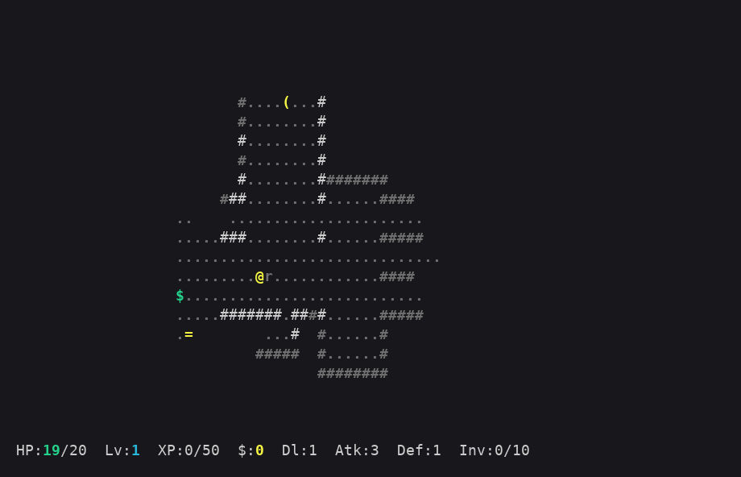

# AdaHack

A NetHack-inspired terminal roguelike written in Ada 2012.

**Goal:** Descend ten dungeon levels, find the **Amulet of Yendor** on level 10,
and carry it back to the surface alive.



## Building

Requires GNAT (Ada compiler), GCC (for the C helper) and `gprbuild`.

```bash
make        # build
make run    # build and run
make clean  # remove build artefacts
```

The build uses a GNAT project file (`adahack.gpr`) and a C helper
(`src/terminal_c.c`) for raw terminal I/O via `termios`.

### Installing

`make install` installs the game and its man page.  By default the game goes
to `/usr/local/games` and the man page to `/usr/local/share/man/man6`:

```bash
make                  # build as yourself first
sudo make install     # install to /usr/local
sudo make uninstall   # remove again
man adahack
```

Override `PREFIX` (and optionally `BINDIR` / `MANDIR`) to install elsewhere,
for example into your home directory without `sudo`:

```bash
make install PREFIX=$HOME/.local BINDIR=$HOME/.local/bin
```

Use the same variables with `make uninstall`.  `DESTDIR` is supported for
staged installs and packaging.  To read the man page without installing it,
run `man -l doc/adahack.6`.

## Controls

| Key | Action |
|-----|--------|
| `h j k l` | Move left / down / up / right |
| `y u b n` | Move diagonally (NW / NE / SW / SE) |
| Arrow keys | Move (same as hjkl) |
| `>` | Descend stairs |
| `<` | Ascend stairs (+ Amulet at level 1 = **win**) |
| `i` | Inventory - use/equip/eat items |
| `e` | Quick-eat first food ration |
| `r` | Rest one turn (+1 HP) |
| `R` | Auto-rest until full HP or interrupted |
| `S` | Search adjacent tiles for secret doors |
| `f` | Fire readied bow (then pick direction) |
| `K` | Kick (then pick direction) |
| `s` | Browse shop (stand on green `$`) |
| `t` | Teleport (ring of teleportation required) |
| `D` | Drop an item |
| `q` | Quit (asks for confirmation) |

## Map symbols

| Symbol | Meaning |
|--------|---------|
| `@` | You |
| `#` | Wall / secret door |
| `.` | Floor or corridor |
| `+` yellow | Closed door |
| `+` red | Locked door (needs a key) |
| `/` | Open door |
| `^` | Trap (cyan=teleport, red=dart, yellow=pit, magenta=blind) |
| `>` | Stairs down |
| `<` | Stairs up |
| `$` green | Shop tile |
| `$` yellow | Gold |
| `!` | Potion (blue=heal, red=str, foul=poison, murky=blind, sparkling=invis) |
| `?` | Scroll or key |
| `)` white | Weapon |
| `)` cyan | Bow |
| `/` | Arrows |
| `[` | Armor |
| `%` | Food ration |
| `(` | Torch |
| `=` | Ring |
| `"` | Amulet of Yendor |
| `r B` | Rat / Bat |
| `g o` | Goblin / Orc |
| `T` | Troll |
| `D` | Dragon |

## Items

Gold and keys are auto-collected.  All other items go into your pack (10 slots).

**Potions `!`** - drink with `i`:
- Blue: heal HP
- Red: permanently +1 attack
- Foul-smelling: poison damage (risky!)
- Murky: temporary blindness (risky!)
- Sparkling: temporary invisibility

**Scrolls `?`** - read with `i`:
- Identify, Magic Map, Fireball, Enchant Weapon, Enchant Armor, Teleport

**Weapons `)`** - wield with `i`. Negative value = cursed.
**Bow `)` cyan** - ready with `i`, then fire with `f`.
**Arrows `/`** - carried automatically; used when firing the bow.
**Armor `[`** - wear with `i`. Negative value = cursed.
**Rings `=`** - wear with `i`. Rings wear out after 80-200 turns.
  - Regeneration: +1 HP every 5 turns
  - Invisibility: monsters won't wake on proximity
  - Speed: +2 attack
  - Teleportation: press `t` to teleport at will
**Torch `(`** - light with `i`. Illuminates dark rooms. Burns out eventually.
**Food `%`** - eat to restore HP and reset hunger.

## Dungeon features

**Dark rooms** - some rooms are unlit. Without a torch, vision shrinks to 2
tiles. A lit torch extends this to 6 tiles.

**Secret doors** - hidden in walls. Press `S` when adjacent to search. They
reveal as closed doors once found.

**Traps** - invisible floor tiles with nasty effects. Revealed when triggered.
Known traps are shown as `^`.

**Shops** - appear on random levels. Stand on the green `$` tile and press `s`.
Buy with a letter key, sell with `S`.

## Monsters

| Monster | Notes |
|---------|-------|
| Rat `r` | Weak; common on level 1 |
| Bat `B` | May blind you on a hit |
| Goblin `g` | Appears from level 2 |
| Orc `o` | Tougher; appears from level 2 |
| Troll `T` | Regenerates 1 HP every 5 turns |
| Dragon `D` | Fire-breathes at up to 4 tiles range |

## Hunger

Your hunger decreases every turn. Resting drains it twice as fast.
- **Hungry** (below 300): shown in the status bar
- **Starving** (below 0): lose 1 HP every 5 turns
- Eating food resets hunger to full.

## Combat

Move into a monster to attack it. Each attack is resolved in two steps:

1. **To hit:** roll `d20 + attack`. The attack hits if the total is at least
   `10 + defender's defense`. A natural 20 always hits, a natural 1 always
   misses.
2. **Damage:** on a hit, roll damage. Defense does not reduce damage - it
   makes you (or the monster) harder to hit.

| Attacker | Attack used for to-hit | Damage on a hit |
|----------|------------------------|-----------------|
| You (melee) | base attack + weapon + ring of speed | `1d6 + weapon bonus` (min 1) |
| You (bow) | base attack + bow accuracy | `1d6` |
| Rat `r` | 1 | 1-3 |
| Bat `B` | 1 | 1-2 |
| Goblin `g` | 2 | 1-4 |
| Orc `o` | 3 | 2-6 |
| Troll `T` | 5 | 3-9 |
| Dragon `D` | 8 | 4-12 (plus fire breath) |

Your defense is base defense + armor. For example, a fresh character
(attack 3, defense 1) hits a rat 70% of the time, and a rat hits you 55% of
the time for 1-3 damage.

Killing monsters earns XP. Levelling up raises max HP, attack, and defense.

## Scoring

`gold * 2  +  XP  +  dungeon_depth * 50`  (+10 000 for winning)

## Source layout

```
src/
  adahack.adb        - entry point
  terminal_c.c       - C: raw termios + single-byte reads
  terminal.ads/adb   - ANSI terminal output + key input
  game_types.ads     - all shared data types
  dungeon_gen.ads/adb - map generation, FOV, monster factory
  game.ads/adb       - game state, loop, combat, inventory, rendering
doc/
  adahack.6          - Linux man page (groff format)
```

## License

Copyright (C) 2026 Ulrik Hørlyk Hjort.  Released under the MIT License - see
the header at the top of any source file for the full text.
